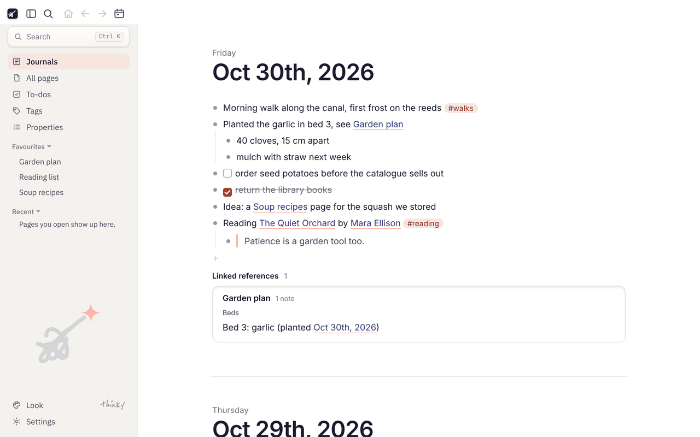
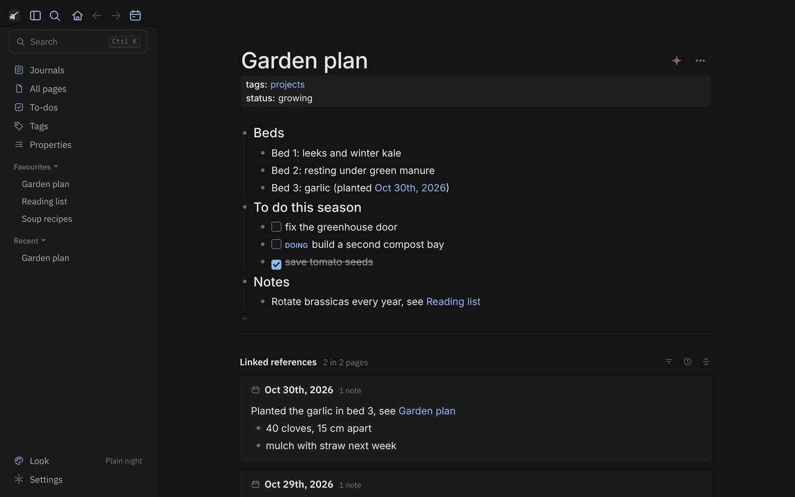
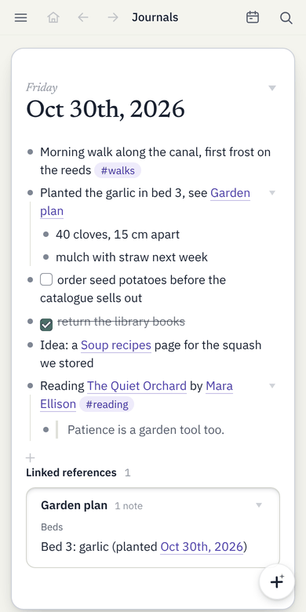
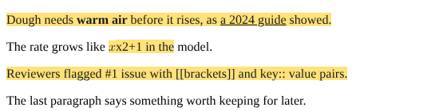
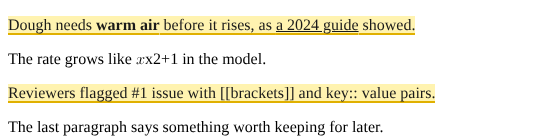
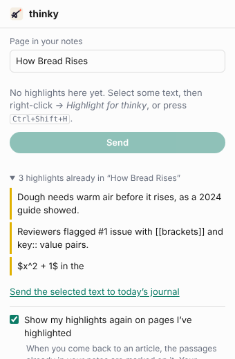

<figure class="shot hero-shot">
  
  <figcaption>Today's journal on a laptop. The notes are made up.</figcaption>
</figure>

<!-- Why it exists -->
<section class="block" id="why">
  
Why I built it

  <h2>Notes that outlive any one app</h2>
  

    

      <ul class="facts">
        <li><b>Inspired by</b> Obsidian and Logseq</li>
        <li><b>No lock-in:</b> every note is a plain Markdown file</li>
        <li><b>Links</b> keep out-of-sight ideas in reach</li>
        <li><b>Works well with AI</b>, which reads and writes the same files</li>
      </ul>
    

thinky grew out of years of using Obsidian and Logseq, two apps that taught me to write in small linked notes instead of long documents. I wanted that way of working in something lean that starts in a moment, on my laptop and my phone.

I also didn't want to be locked in. Markdown doesn't belong to any one program: it's plain text that any editor can open, today or in twenty years. thinky works on the same files Logseq uses, so you can switch between the two, or stop using both, and your notes stay yours.

Links are the heart of it. Out of sight is out of mind, and a link is how a note I wrote months ago comes back when it matters. Each page shows every note that points to it, so the context travels with the idea.

Plain linked files also work very well with AI. An assistant can read the same folder, follow the links to gather context, and write notes back in the same format, with no export and no special plug-in.

  

</section>

<!-- What it does -->
<section class="block" id="features">
  
What it does

  <h2>Small, fast and safe with sync</h2>
  

    

      <h3>Write and link</h3>
      
Journals and pages, with links, tags, properties, linked and unlinked references, to-dos and fast search that forgives typos in page names.

    

    

      <h3>Safe with sync</h3>
      
Keep the folder in Google Drive or Syncthing. If a page changed on another device, thinky merges the two, and nothing is ever silently overwritten.

    

    

      <h3>Quick capture</h3>
      
A shortcut key on Windows, home-screen widgets and the share sheet on Android, and highlights from your browser.

    

  

  

    <figure class="shot">
      
      <figcaption>A page in the Plain night look, with the notes that link back to it.</figcaption>
    </figure>
    <figure class="shot phone">
      
      <figcaption>On a phone.</figcaption>
    </figure>
  

</section>

<!-- Browser extension -->
<section class="block" id="highlights">
  
Browser extension

  <h2>thinky highlights</h2>
  
Mark passages as you read in Edge or Chrome and send them to your notes, each with a link back to its spot in the article. Come back to the page later and the passages you kept are marked again.

  

    <a class="btn primary" href="https://chromewebstore.google.com/detail/ggainimehhgjmblabbjkiemfhhlhcgnk" rel="noopener">Get it for Chrome</a>
    <a class="btn" href="https://microsoftedge.microsoft.com/addons/detail/cpdmmmcipjfebaemgdnbamipolboaokn" rel="noopener">Get it for Edge</a>
    <a class="btn" href="https://srikanth-iyer.github.io/thinky/highlights.html" rel="noopener">How highlights work</a>
  

  

    

      <figure class="shot">
        
        <figcaption>New highlights, not sent yet.</figcaption>
      </figure>
      <figure class="shot">
        
        <figcaption>Back on the article: passages already in your notes.</figcaption>
      </figure>
    

    <figure class="shot">
      
      <figcaption>The extension's box lists them too.</figcaption>
    </figure>
  

</section>
